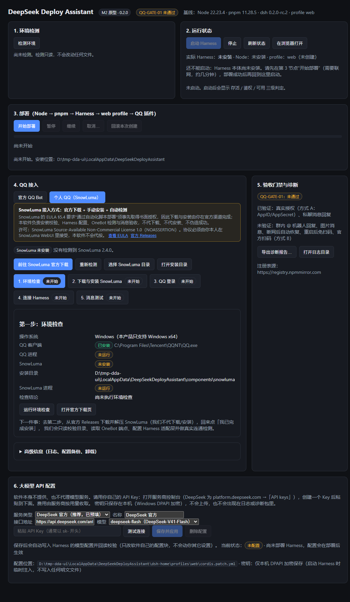
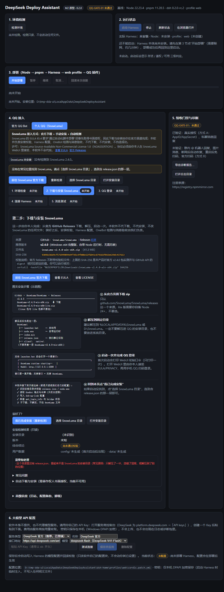

# M3.3.1 实施记录：SnowLuma 用户引导安装流程

**日期：** 2026-11-03
**性质：** 流程调整（保留 M3.3 全部工程成果，不重写个人 QQ 模块）
**基线：** [M3.3 实施报告](./M3.3-实施报告.md)
**测试：** `tsc` 0 错误；`vitest` **279 passed / 6 skipped**（新增 11 个用例）；license gate OK

---

## 0. 结论摘要

| # | 结论 |
|---|---|
| 1 | 个人 QQ 页已改为 **五步向导**：环境检查 → 下载与安装 SnowLuma → QQ 登录 → 连接 Harness → 消息测试 |
| 2 | 第二步变成**官方链接 + 图文引导 + 只读校验**：官方 Releases 按钮、推荐版本 v2.4.0、文件名、大小、SHA-256、4 步示意图、FAQ、「我已完成安装（重新检测）」、目录选择 |
| 3 | 新增**安装位置自动发现与逐项校验**（`release.json` / `node.exe` / `index.mjs` / `launcher.bat` / `client/` / `native/`），并能自动下钻"解压多套了一层"的目录 |
| 4 | M3.3 的下载/安装/配置/启动服务**全部保留**，但只在清单登记书面授权时才会执行；未授权时折叠显示为「受许可限制」，不会被显示成成功 |
| 5 | 真实 QQ 双向消息仍未验收（无可用的书面授权与真实扫码），本文件不做任何"已通过"的声明 |

---

## 1. 新旧流程对比

| 步骤 | M3.3（调整前） | M3.3.1（当前） |
|---|---|---|
| 第 1 步 | 环境检查（QQ/SnowLuma/磁盘/网络） | 同左，并补充 SnowLuma 进程、安装目录、真实版本 |
| 第 2 步 | 「自动部署」：release → download → install → configure → start，未授权时 5 步全 `blocked` | **「下载与安装 SnowLuma」**：官方下载入口 + 图文教程 + 只读校验 + 目录选择；自动部署降级为折叠区（仅授权时可用） |
| 用户操作 | 无（但实际不可执行，因为许可闸门） | 用户自己下载/解压/启动一次，回来点「我已完成安装」 |
| 软件职责 | 全自动（被许可闸门拦住） | **校验安装 + 读 OneBot 端点/令牌 + 写 dsh-qq-link 配置 + 检测登录与 bridge + 消息验收** |
| 第 3 步 | QQ 登录（WebUI/扫码/登录检测） | 同左，补充"先双击 launcher.bat"的前置说明 |
| 第 4 步 | Harness 连接（插件/端点/令牌/bridge/绑定） | 同左（标题统一为「连接 Harness」） |
| 第 5 步 | 连接验收 | **「消息测试」**（标题对齐任务书；判定逻辑不变：必须用户确认收到真实回复） |
| 顶部主按钮 | 「开始部署」 | **「前往 SnowLuma 官方下载」** |
| 诚实性 | 未授权步骤 `blocked`、不假成功 | 保持不变；新增"没找到安装目录"必须明确说没找到 |

---

## 2. 修改文件清单

### 新增

| 文件 | 说明 |
|---|---|
| `packages/core/src/snowluma/locate.ts` | `verifyInstallDir()`（逐项只读校验 + 父目录自动下钻）、`discoverInstallDirs()`（常见目录有界扫描）、`looksLikeSnowLumaDir()` |
| `tests/core/snowluma-locate.test.ts` | 8 个用例：校验通过/父目录下钻/无 release.json/lite 缺 node.exe/版本不一致/下载目录命中/候选排序/受管目录 |
| `scripts/m331-ui-smoke.mjs` | 新流程 UI 冒烟 + 截图（替代旧的 `m33-ui-smoke.mjs`：旧脚本点击的「开始部署」在新 UI 中已不存在） |
| `docs/evidence/m331-ui-step1-env.png` | 第一步截图 |
| `docs/evidence/m331-ui-step2-guide.png` | 第二步（官方下载 + 图文引导）截图 |
| `docs/evidence/m331-ui-step2-recheck.png` | 点「我已完成安装」后的真实检测结果截图 |
| `docs/evidence/m331-official-links.log` | 本次官方链接可达性核实 |
| `docs/evidence/m331-{typecheck,full-tests}.log` | 全量验证日志 |

### 修改

| 文件 | 变更 |
|---|---|
| `packages/spec/src/snowluma-deploy.ts` | 新增 `SnowLumaVerifyInstallSchema`、`SnowLumaUseInstallSchema` |
| `packages/core/src/index.ts` | 导出 `snowluma/locate` |
| `apps/desktop/src/main/services/personal-qq-service.ts` | `guide()` 增加 `asset`（官方文件名/大小/SHA-256/URL），供引导页展示，来源仍是清单 |
| `apps/desktop/src/main/services/snowluma-deployment-service.ts` | 新增 `discoverInstall()` / `verifyInstall()` / `useInstallDir()`；支持注入 `env`（可测） |
| `apps/desktop/src/main/ipc/register.ts` | 新增 `personal:install-discovery` / `install-verify` / `install-use`；`personal:pick-install-dir` 改为只返回路径（校验通过后才落盘） |
| `apps/desktop/src/preload/index.ts` | 对应 3 个白名单方法 |
| `apps/desktop/src/renderer/src/components/PersonalQqPanel.tsx` | 第二步重写为引导安装；顶部横幅与主按钮调整；步进器五步改名；新增检测结果表、候选目录、FAQ、折叠的自动部署 |
| `apps/desktop/src/renderer/src/styles.css` | 新增 `.install-card` / `.tutorial-step` / `.tutorial-art` / `code.hash` |
| `tests/desktop/snowluma-deployment-service.test.ts` | 新增 3 个 M3.3.1 用例（校验并采用目录/选错目录拒绝/常见目录发现） |
| `docs/README.md` | 索引新增 M3.3.1 |

### 未改动（刻意保留）

- `packages/core/src/snowluma/{release,download,install,config,process,health,deploy,uninstall}.ts`：M3.3 的下载/安装/配置/启动/卸载实现原样保留，授权闸门不变。
- `packages/core/src/qq/personal/*`：八相位检测、bridge 读取、令牌只进主内存、`redirect: 'manual'` 修复。
- 官方 QQ Bot 全部代码路径。

---

## 3. 官方下载链接核实结果

| 项 | 值 | 来源 |
|---|---|---|
| 仓库 | `SnowLuma/SnowLuma`（GitHub 组织 SnowLuma） | GitHub API（同日更早一次成功调用，见 [m33-real-package.log](./evidence/m33-real-package.log)） |
| 发行版页 | `https://github.com/SnowLuma/SnowLuma/releases/tag/v2.4.0` | `HEAD` → 200 |
| Windows x64 包 | `SnowLuma-v2.4.0-win-x64.zip` | Releases API |
| 下载地址 | `https://github.com/SnowLuma/SnowLuma/releases/download/v2.4.0/SnowLuma-v2.4.0-win-x64.zip` | `HEAD` → 302 → `release-assets.githubusercontent.com/...`（见 [m331-official-links.log](./evidence/m331-official-links.log)） |
| 大小 | `43,339,979 B`（UI 显示 41.3 MB） | API `size` + 实际下载 `Length` |
| SHA-256 | `93096cb6d4cf576999094e9f7d1c9fb08e22f6b41c879182f015e639dc437613` | 实际下载计算 = API `digest` = 内置清单，三者一致 |
| EULA | `https://raw.githubusercontent.com/SnowLuma/SnowLuma/main/EULA.md` | `HEAD` → 200 |
| LICENSE | `https://raw.githubusercontent.com/SnowLuma/SnowLuma/main/LICENSE` | `HEAD` → 200 |
| 校验和文件 | **官方 Releases 不提供** | 资产列表实测只有 6 个包 |

> **限流说明（真实用户也会遇到）**：本次核查时 GitHub REST API 对当前出口 IP 返回未认证限流（60 次/小时）。应用侧对此是**安全降级**：`resolveRelease()` 收到非 200 时记一条证据"改按清单校验哈希"，随后下载完成仍强制校验 SHA-256，不会因为 API 不可用就放行来路不明的文件。UI 上这条说明出现在第二步的校验说明里。

**没有使用任何第三方下载站**：`officialAssetProblems()` 会拒绝非 `https://github.com/SnowLuma/SnowLuma/releases/download/v<版本>/<文件名>` 形状的地址。

---

## 4. UI 截图（本次实机运行，隔离 `LOCALAPPDATA`）

第一步：环境检查



第二步：官方下载 + 图文安装引导（含版本/文件名/SHA-256/示意图/FAQ/折叠的自动部署）


点「我已完成安装（重新检测）」后的真实结果（本机未装 SnowLuma → 明确说明"没有 release.json"，不显示成功）



---

## 5. 自动检测测试结果

### 5.1 核心用例（`tests/core/snowluma-locate.test.ts`，8 个，全绿）

| 用例 | 断言要点 |
|---|---|
| 校验通过 | `valid=true`、版本=清单版本、7 项检查全通过、`hasConfig=false` |
| 父目录自动下钻 | 选 `Downloads\` 时自动定位到 `Downloads\SnowLuma-vX-win-x64\`（`resolvedFromChild=true`） |
| 无 `release.json` | `exists=false` + 明确原因（"只解压了一半/选错层级/解压到别处"） |
| lite 版缺 `node.exe` | `valid=false` 且问题里点名 `node.exe` |
| 版本不一致 | 仍可识别，但标记"与推荐版本不符"并给出实际版本 |
| 下载目录命中 | `profile-scan` 找到候选且校验通过 |
| 候选排序 | 用户已保存目录排第一；无效目录仍返回以解释原因；空受管目录不算"已安装" |
| 受管目录 | 装好后同样被识别 |

### 5.2 主进程接线（`tests/desktop/snowluma-deployment-service.test.ts`，新增 3 个）

- `verifyInstall(dir)` → `valid=true`、版本正确
- `useInstallDir(dir)` → 写入设置并更新快照的 `installDir`
- `useInstallDir(错目录)` → `ok=false`、提示含 `release.json`、**不写入设置**
- `discoverInstall()` → 返回 `expectedVersion` 与候选，推荐项有效

### 5.3 UI 实机冒烟（`scripts/m331-ui-smoke.mjs`）

```
step1Checks: wizard/envCard/qqRow/snowlumaRow/officialButton/noFakeSuccess = 全部 true
step2Checks: title/version/fileName/sha256/verifyHint/tutorial/faq/doneButton/autoFolded = 全部 true
recheck: 2.1s 完成，honesty.notFound=true（本机未安装），truthful=true
screenshots: 3 张（见 §4）
```

关键诚实性断言：未找到安装目录时页面必须出现「没有在常见位置找到 SnowLuma」，且**不得**出现"校验通过/已完成"之类文案。

---

## 6. Harness 配置测试结果

| 项 | 结果 | 证据 |
|---|---|---|
| `link` 步骤编排（安装插件 → 写端点+令牌 → 读 bridge） | 通过（单测注入） | `tests/core/snowluma-deploy.test.ts` |
| 适配插件安装/卸载（`dsh plugin add/remove`） | 通过（既有单测） | `tests/desktop/personal-qq-service.test.ts` |
| 插件状态接口白名单解析（令牌不外泄） | 通过 | `tests/core/qq-personal-bridge.test.ts` |
| 真实 Harness 上 `dsh-qq-link@1.5.1` 可装/可载/状态可读 | **沿用 M3.2 S5 真实证据**（本轮未重跑，因为需要先有可用的 SnowLuma 且本轮不启动用户环境） | [s5-adapter-real-2026-11-03.md](./evidence/QQ-GATE-02/s5-adapter-real-2026-11-03.md) |
| 配置备份/恢复 | 通过（8 个用例） | `tests/core/snowluma-config.test.ts` |
| 写入 `OneBot` 端点与令牌 | 代码路径通过（单测），真实写入需 SnowLuma 运行并登录 | `snowluma-deploy.test.ts` |

> 说明：M3.3.1 没有改变 Harness 侧的任何实现，只是把"何时由谁装 SnowLuma"改了。因此 Harness 配置部分沿用 M3.3 / M3.2 的结论，未重复造新证据。

---

## 7. 尚未完成的真实 QQ 验收项目

| QQ-GATE-02 项 | 状态 | 阻塞原因 |
|---|---|---|
| 1 组件就位（版本与哈希） | 待验证（用户在官方下载即满足） | 需用户在目标机装好后点「我已完成安装」留下记录 |
| 2 hook 注入成功 | 待验证 | 需真实 QQ 登录 |
| 3 OneBot `get_login_info` | 待验证 | 需 SnowLuma 运行 + 登录 |
| 4 适配层联通（bridge state） | 待验证（M3.2 已单独验证过状态接口） | 需 1~3 先就绪 |
| 5 私聊消息到达 Harness | **未验证** | 需真实 QQ 账号双向发消息 |
| 6 Harness 调用 DeepSeek API | **未验证** | 需 5 就绪 + 用户自己的 API Key |
| 7 AI 回复返回 QQ | **未验证** | 需 5/6 就绪 |
| 8~11 群聊/图片/断线/重启 | 未验证 | 同上 |
| 12 双路线隔离与卸载 | 代码与单测完成 | 需真实环境跑一次 |

**不做的事**：不使用 Mock 结果充当验收、不把"用户手动完成"写成"软件自动完成"、不伪造 `authorizationRef`。

---

## 8. 如何复现本次验证

```powershell
# 1) 静态与单测
node .\node_modules\typescript\bin\tsc --noEmit -p tsconfig.json
node .\node_modules\vitest\vitest.mjs run

# 2) 官方真包（需先自行从官方下载到本地，仅读取与解压，不运行）
$env:DDA_REAL_SNOWLUMA_ZIP="D:\path\to\SnowLuma-v2.4.0-win-x64.zip"
node .\node_modules\vitest\vitest.mjs run tests/integration/snowluma-real-package.test.ts

# 3) UI 冒烟（隔离 LOCALAPPDATA，不污染真实用户数据）
#    先构建并启动：
node .\node_modules\electron-vite\bin\electron-vite.js build
$env:LOCALAPPDATA="D:\tmp-dda-ui\LocalAppData"; $env:USERPROFILE="D:\tmp-dda-ui\profile"
Start-Process node_modules\electron\dist\electron.exe -ArgumentList ".","--remote-debugging-port=9338","--user-data-dir=D:\tmp-dda-ui\chromium"
#    再跑：
node scripts\m331-ui-smoke.mjs 9338
```

---

## 9. 许可边界（重申）

- `authorizationRef` 仍为空：自动下载/安装/配置/启动在 UI 中显示为「受许可限制」，不执行、不假成功。
- 用户手动安装后，我们只做：只读校验、读取 OneBot 端点与令牌（仅主进程内存）、写入 `dsh-qq-link` 配置（我们自己的插件）、健康探测、配置备份/恢复、卸载。
- 不代用户接受 EULA/PRIVACY；不修改 SnowLuma 源码或可执行文件；不打包、不镜像、不再分发。
